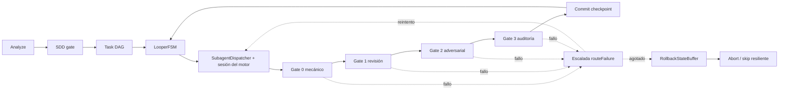

# Referencia y Arquitectura del CLI (`openspec-cascade`)

`openspec-cascade` ejecuta cambios [OpenSpec](https://github.com/Fission-AI/OpenSpec) de forma autónoma, tarea por tarea, con una sesión aislada de agente por cada ítem de `tasks.md`. El arnés —no el modelo— decide cuándo una tarea está terminada: ejecuta la verificación determinista, reinyecta los fallos al agente y solo confirma (commit) trabajo verificado.

El mismo código fuente TypeScript corre en **Bun 1.4+** y en **Node.js 24 LTS**.

---

## 1. Principios de diseño

1. **El arnés es el oráculo.** Los comandos de verificación (`Verify:` en `tasks.md`, `--full-gate`, Gates 0–3) los ejecuta el arnés; el código de salida `0` es la única prueba aceptada.
2. **Soberanía de Git.** El agente no puede hacer `commit`, `push`, `reset`, `checkout`, `stash` ni migraciones. El arnés es dueño de Git y del buffer de rollback.
3. **Estado idempotente.** El estado vive en `tasks.md`, Git y `.cascade/` (telemetría, caché). Una ejecución interrumpida se reanuda en la primera tarea pendiente.
4. **Fail-closed.** Entradas inválidas, presupuestos agotados, ramas protegidas (`main`, `master`, `stable`) o árboles sucios detienen la ejecución con código `2`.
5. **Spec antes que código.** El hook SDD del plugin y la puerta SDD del pipeline v2 bloquean cambios de código de producción sin un cambio OpenSpec activo.

---

## 2. Ejecución en Bun y en Node.js 24

```bash
# Bun (recomendado)
bun run cascade.ts --repo <ruta> --changes cambio-a,cambio-b

# Node.js 24 LTS (sin transpilar: el hook resuelve imports sin extensión)
node --import ./scripts/node_ts_register.mjs cascade.ts --repo <ruta> --changes cambio-a --dry-run
```

Toda ejecución de procesos pasa por el puerto `ISpawner` (`src/runtime/`): `BunSpawner` en Bun y `NodeSpawner` en Node. Ambos aíslan cada proceso en su propio grupo, matan el árbol completo en timeout/abort (`SIGTERM` → `SIGKILL` tras una gracia) y devuelven `124` en timeout.

---

## 3. Modos de ejecución (`--mode`)

### `--mode v1` (por defecto)

Bucle secuencial: por cada tarea pendiente se abre una sesión del motor, se ejecutan los comandos `Verify:` (hasta `--max-attempts` intentos con el fallo reinyectado), se marca la tarea y se hace commit por tipo o por sección. Si se agotan los intentos se ejecuta el rollback de Git (`--no-rollback` lo desactiva) y la ejecución se detiene, salvo con `--resilient`.

**Fast-track de docs.** Si tras la sesión todos los ficheros tocados respecto al último commit verificado son documentación (`.md`, `.rst`, `LICENSE`, `README*`, `CHANGELOG*`; se ignoran los artefactos de `.cascade/` y `.agents/teamwork/`), se omiten los comandos de typecheck, test y build y se avisa en el log (`fast-track: …`). No cuentan como docs `.txt`, `.mdx`, `AGENTS.md`, `CLAUDE.md`, `SKILL.md` ni nada bajo `.claude/`, `.agents/` u `.opencode/`, y un comando que nombra docs (`build:docs`, `test:links`) nunca se omite. Lint y cualquier comando no reconocido se siguen ejecutando. Ante cualquier duda (git falla, lista vacía, código mezclado) se ejecuta todo, y `--full-gate` o una tarea con "full verification" lo desactivan.

### `--mode v2` (pipeline FSM)



- **Analyze** (`analyzeChangeArtifacts`) bloquea cambios con brechas entre proposal, specs y tasks.
- **HarnessInjector** construye el prompt determinista: tarea, reglas, directivas de remediación, artefactos del cambio, constitución (`openspec/project.md`), skills, contexto Greptile y guardarraíles.
- **Gates 1–3 reciben el diff completo del árbol de trabajo** (incluidos archivos nuevos sin seguimiento) calculado mediante un *shadow commit*, sin tocar el índice del usuario.
- **Gate 2** (sondas adversariales sintetizadas) se ejecuta con `--full-gate` cuando Bun está disponible y hay archivos de código.
- Los artefactos de los gates viven en `.agents/teamwork/` y nunca entran en los commits; el estado de la ejecución se persiste con `MemoryStorage`.

---

## 4. Motores (`--engine`)

| Motor | Alias | Transporte | Notas |
|---|---|---|---|
| `claude` | — | Claude Agent SDK | Por defecto; medidores de uso del plan (`--usage-limit`). |
| `opencode` | — | CLI `opencode run --format json` | Modelo `proveedor/modelo#variante`. |
| `antigravity` | `agy`, `gemini` | CLI `agy` | Coste estimado por tokens. |
| `jules` | — | CLI `jules remote` vía `PalEngineBridge` | Autenticación interactiva `jules login`; la API REST usa `X-Goog-Api-Key`. |

Cada motor se construye con `EngineFactory` y se envuelve con `ResilientEngineDecorator` (reintentos con backoff exponencial + jitter y *circuit breaker*) y `TelemetryMetricsDecorator` (latencia, coste, tokens, reintentos, categoría de error).

---

## 5. Opciones

| Opción | Variable de entorno | Descripción |
|---|---|---|
| `--repo <ruta>` | `CASCADE_REPO` | Repositorio destino (por defecto el directorio actual). |
| `--changes a,b,c` | `CASCADE_CHANGES` | Cambios OpenSpec en orden de cascada. Los ids deben cumplir `[A-Za-z0-9][A-Za-z0-9._-]*` (sin separadores ni `..`). |
| `--engine <nombre>` | `CASCADE_ENGINE` | `claude`, `opencode`, `antigravity` (`agy`, `gemini`) o `jules`. |
| `--model <nombre>` | `CASCADE_MODEL` | Modelo para el motor seleccionado. |
| `--effort <nivel>` | `CASCADE_EFFORT` | `low`, `medium`, `high`, `max` o `none`. |
| `--mode <v1\|v2>` | — | Pipeline secuencial (`v1`) o FSM con Gates 0–3 (`v2`). |
| `--config <ruta>` | `CASCADE_CONFIG` | Archivo `.openspec-cascade.json`. |
| `--budget <usd>` / `--max-budget` | `CASCADE_MAX_BUDGET_USD` | Presupuesto máximo por sesión (`>=` detiene). |
| `--total-budget <usd>` | `CASCADE_TOTAL_BUDGET_USD` | Presupuesto total de la cascada. |
| `--usage-limit <%>` | `CASCADE_USAGE_LIMIT_PERCENT` | Límite de uso del plan (1–100). |
| `--max-turns <n>` | `CASCADE_MAX_TURNS` | Turnos máximos por sesión. |
| `--max-attempts <n>` | `CASCADE_MAX_ATTEMPTS` | Intentos máximos por tarea. |
| `--allow-dirty` | `CASCADE_ALLOW_DIRTY` | Permite iniciar con el árbol sucio. |
| `--dry-run` | `CASCADE_DRY_RUN` | Muestra el plan (y en v2 el veredicto de Analyze y el orden del DAG) sin ejecutar ni escribir logs. |
| `--full-gate` | `CASCADE_FULL_GATE` | Verificación completa en cada tarea con commit; habilita Gate 2 en v2. |
| `--no-keep-alive` | `CASCADE_KEEP_ALIVE=false` | Desactiva el inhibidor de suspensión (`caffeinate` / `systemd-inhibit`). |
| `--log-dir <ruta>` | `CASCADE_LOG_DIR` | Directorio de logs JSONL (por defecto `~/.cache/openspec-cascade/logs/<repo>`). |
| `--settings <archivo>` | `CASCADE_SETTINGS` | Settings extra de Claude Code para cada sesión (solo motor `claude`), p. ej. un sandbox para ejecuciones desatendidas. Se resuelve contra el directorio actual; si no existe, la ejecución se detiene con `2`. |
| `--no-diagrams` | `CASCADE_AUTO_DIAGRAMS=false` | Desactiva la sincronización de diagramas al completar un cambio. |
| `--graphify-command <cmd>` | `CASCADE_GRAPHIFY_COMMAND` | Comando para actualizar el grafo Graphify. |
| `--archify-action <acción>` | `CASCADE_ARCHIFY_ACTION` | Acción de Archify (por defecto `deliver`). |
| `--archify-quality <perfil>` | `CASCADE_ARCHIFY_QUALITY` | Perfil de calidad de Archify (por defecto `showcase`). |
| `--archify-bin <ruta>` | `CASCADE_ARCHIFY_BIN` | Binario o prefijo de comando de Archify. |
| `--no-rollback` | `CASCADE_ROLLBACK_ON_FAILURE=false` | Conserva el árbol de trabajo cuando una tarea falla. |
| `--resilient` / `--continue-on-failure` | `CASCADE_RESILIENT` | Continúa con la siguiente tarea tras un fallo (con rollback). |
| `-h`, `--help` | — | Muestra la ayuda. |

#### `alwaysVerify`

Lista de comandos que se ejecutan como checks en todas las tareas. Solo se define en el archivo de configuración (no tiene flag ni variable de entorno) y está vacía por defecto. Ejemplo (un check de arquitectura):

```json
{ "alwaysVerify": ["bun run check:architecture"] }
```

- Solo aplica en v1; en v2 se ignora y se emite una advertencia.
- Los comandos se ejecutan exactamente como están escritos.
- Los comandos con operadores de shell se rechazan al cargar la configuración.
- Se ejecuta una pasada base antes de la primera tarea; si falla, la ejecución se detiene.

Precedencia: overrides programáticos > CLI > `CASCADE_*` > `.openspec-cascade.json` > valores por defecto.

### Comandos de verificación desde `tasks.md`

Solo se aceptan spans entre backticks que empiecen por `bun`, `bunx`, `npm`, `pnpm`, `yarn` o `tsc --noEmit`, y **se descartan** los que contengan operadores de control de shell (`;`, `&`, `|`, `` ` ``, `$(`, `${`, `>`, `<`, saltos de línea). Si no queda ninguno se aplica la verificación por defecto.

**Marcador Verify.** El segmento Verify de una tarea empieza en su marcador: la primera línea de continuación indentada que empieza con un marcador de lista opcional (`-` o `*`) seguido de `Verify:` (la misma regla `VERIFY_LINE` que usa el verificador de `tasks.md`). Si la tarea no tiene esa línea, se usa como marcador el primer `Verify:` de la propia línea de la tarea que quede fuera de los backticks (forma en línea, conservada por compatibilidad; las ejecuciones reales exigen la línea indentada). Un `Verify:` dentro de backticks o a mitad de una línea de continuación no es marcador.

Solo el segmento Verify produce checks. Los comandos escritos antes del marcador se ignoran y se informan en el log de la ejecución y en el plan de `--dry-run`.

---

## 6. Subcomandos

| Subcomando | Uso | Salida |
|---|---|---|
| `doctor` | `cascade.ts doctor [--repo <ruta>] [--run-project-checks]` | Diagnóstico de runtime, git, OpenSpec, binarios de motores, Greptile, sincronía de hooks y telemetría. `0` si no hay checks `fail`. |
| `setup` | `cascade.ts setup discover [--json] [--repo <ruta>]`<br>`cascade.ts setup add --scope <project\|global> --name <n> --type <t> --when <frase> [--required] [--check <cmd>] [--profile <p>] [--host <h>]...`<br>`cascade.ts setup remove --scope <project\|global> --name <n> --type <t>`<br>`cascade.ts setup show [--json] [--repo <ruta>]`<br>`cascade.ts setup rules [--write]` | Descubre los helpers (servidores MCP, skills, plugins y herramientas CLI), registra o quita una entrada del manifiesto, muestra el manifiesto fusionado de las capas global y de proyecto e imprime (o con `--write` añade) las reglas sugeridas para `openspec/config.yaml`. Nunca instala nada. `0` si termina bien; `1` si `rules --write` se niega porque ya existe la clave `rules`; `2` por uso inválido o manifiesto inválido. Ver [Manifiesto de helpers](#manifiesto-de-helpers-setup). |
| `catalog` | `cascade.ts catalog --sync --owner <o> --project <n> [--owner-type user\|organization] [--output <dir>]` | Genera el catálogo de tareas desde un GitHub Project (requiere `gh` autenticado). |
| `drift` | `cascade.ts drift --catalog <archivo> (--remote-json <archivo> \| --owner <o> --project <n>)` | Compara el catálogo local con el proyecto o con una instantánea JSON. `1` si hay drift. |
| `review` | `cascade.ts review --base <rama> [--rounds <n≤3>] [--repo <ruta>] [--engine <motor>]` | Bucle pre-PR acotado: revisión Greptile sobre un shadow worktree, corrección automática de hallazgos mecánicos, parada en hallazgos de riesgo. `0` si queda limpio. |
| `spec-gate` | `cascade.ts spec-gate check --stage <review\|drift> --changes <a,b> [--repo <ruta>]`<br>`cascade.ts spec-gate stamp --stage <review\|drift> --change <a> --status <resolved\|open> [--repo <ruta>]` | Comprueba (`check`) o sella (`stamp`) los informes EGM `review.md` y `drift.md` de un change de OpenSpec. `0` si todos los changes pasan; `1` si alguno falta, está abierto, caducó, no tiene bloque de estado, está archivado o no tiene carpeta de change. |
| `lint-tasks` | `cascade.ts lint-tasks --changes <a,b> [--repo <ruta>]` | Revisa el `tasks.md` de cada change: bloques de código (`no-code-block`) y tareas sin marcar que no tienen una línea `Verify:` sangrada (`missing-verify`). Los hallazgos salen por stderr como `<change>: tasks.md:<línea>: <regla> <mensaje>`. `0` si todos pasan; `1` si hay hallazgos; `2` por uso inválido, incluido un `tasks.md` que falta (a diferencia de `spec-gate check`, que sale con `1` si falta un informe, porque `tasks.md` es una entrada obligatoria y el informe es un artefacto generado). También revisa `manual.md` cuando existe (`missing-check`, `manual-checkbox`) y sale con `1` si tiene hallazgos; en `tasks.md` añade la regla `manual-step`. |

Códigos de salida de los subcomandos: `0` éxito, `1` hallazgos/drift/estado no saludable, `2` entrada inválida o error fail-closed (por ejemplo, Greptile no instalado).

### Manifiesto de helpers (`setup`)

El manifiesto registra qué helpers puede usar cada proyecto y cuándo. `setup` descubre y registra; nunca instala. Ninguna ejecución (`run`) lee el manifiesto: solo lo leen `doctor` y `/cascade:explore`.

**Dos capas.**

- Global: `$XDG_CONFIG_HOME/openspec-cascade/manifest.json` (por defecto `~/.config/openspec-cascade/manifest.json`), con la forma `{"entries": [...]}`.
- Proyecto: la clave `manifest` de `.openspec-cascade.json`, con la misma forma.
- Una entrada de proyecto reemplaza a la global con el mismo (`name`, `type`). Dentro de una capa, (`name`, `type`) es único. No se guardan secretos: solo nombres.

**Campos de una entrada** (objeto estricto; un campo desconocido falla):

| Campo | Significado |
|---|---|
| `name` | Nombre del helper. |
| `type` | `mcp`, `skill`, `plugin` o `cli`. |
| `whenToUse` | Obligatorio, una línea, hasta 200 caracteres: cuándo usarlo. |
| `required` | Booleano, `false` por defecto. |
| `check` | Opcional, un único comando (se divide por espacios; sin shell). |
| `profile` | Opcional, nombre no secreto (p. ej. un perfil de AWS); la planificación lo pasa como `--profile`. Solo `[A-Za-z0-9._-]`. |
| `hosts` | Opcional, lista de `claude-code` y `opencode`. |

**Acciones.**

- `discover [--json]`: lista candidatos desde Claude Code (servidores MCP de `~/.claude.json` y `.mcp.json`; skills de `~/.claude/skills` y `.claude/skills`; plugins habilitados en los `settings`), OpenCode (`opencode.json` o `opencode.jsonc` y carpetas `skill`/`skills`) y una lista fija de herramientas CLI en el `PATH`. Solo lee nombres, nunca valores.
- `add --scope project|global --name <n> --type <t> --when <frase> [--required] [--check <cmd>] [--profile <p>] [--host <h>]...`: inserta o reemplaza por (`name`, `type`) (reemplaza en su posición; una nueva va al final). `--host` puede repetirse. Con `--scope global` crea la carpeta si falta. Imprime `added ...` o `updated ...`.
- `remove --scope project|global --name <n> --type <t>`: quita la entrada; si no existe, sale con `2`. Imprime `removed ...`.
- `show [--json]`: manifiesto fusionado, ordenado por nombre y luego tipo. En texto, una línea `<capa> <tipo> <nombre>: <whenToUse>`.
- `rules [--write]`: imprime las reglas sugeridas; con `--write` las añade a `openspec/config.yaml` solo si no tiene clave `rules` (si no, `REFUSED: openspec/config.yaml already has a rules key`, salida `1`; si el archivo no existe, salida `2` y se sugiere `openspec init`).

Un manifiesto que no carga produce un mensaje que empieza por `global layer:` o `project layer:` y nombra la entrada; `setup` sale con `2`, también en `discover` y `show`.

**Forma de `show --json`.**

```json
{"entries": [{"name": "stitch", "type": "mcp", "whenToUse": "...", "required": false, "check": "...", "profile": "...", "hosts": ["claude-code"], "layer": "project"}]}
```

`layer` es `global` o `project`. `required` siempre aparece; `check`, `profile` y `hosts` solo si están definidos.

**Forma de `discover --json`.**

```json
{"candidates": [{"name": "stitch", "type": "mcp", "sources": ["<repo>/.mcp.json"], "hosts": ["claude-code"], "inManifest": null}], "skipped": [{"source": "~/.claude.json", "reason": "invalid JSON"}]}
```

`sources` y `hosts` van ordenados. `inManifest` es `null`, `global` o `project` (`project` si están en ambas). `skipped` lista las fuentes ilegibles con un motivo fijo (`unreadable`, `invalid JSON`, `invalid JSONC`, `unexpected shape`).

**`doctor` y el manifiesto.** `doctor` añade un check por entrada, `manifest:<capa>:<nombre> (<tipo>)`. Ejecuta el `check` de las entradas globales por defecto; el de las entradas de proyecto solo con `--run-project-checks`, porque esa capa viene del repositorio. Una entrada requerida que falla es `fail`; una opcional, `warn` (detalle `timed out`, `not found` o `exit <código>`). Un manifiesto que no carga es un único check `manifest` en `fail`, no un fallo del comando. El `check` se ejecuta con un tiempo límite de 15 s, con `AWS_PAGER` vacío y sin stdin.

**El carácter de solo lectura de un `check` no se impone.** Cascade ejecuta el comando tal cual; que sea de solo lectura es responsabilidad de quien lo escribe. Por eso las capas de proyecto no se ejecutan sin `--run-project-checks`.

**Límite de claude.ai.** Los conectores de claude.ai no se pueden descubrir; hay que registrarlos a mano con `setup add`.

**Claude Code: `/cascade:setup`.** El comando del plugin ejecuta `discover`, propone qué incluir, te deja elegir y escribir un `whenToUse` por helper, pregunta si falta alguno (p. ej. un conector de claude.ai), llama a `add` y ofrece `rules`.

**OpenCode: flujo por CLI.** No hay comando de OpenCode; se usan las acciones directamente:

```bash
bun run cascade.ts setup discover --json --repo <ruta>
bun run cascade.ts setup add --scope project --name stitch --type mcp --when "Antes de tareas de UI, consulta el diseño" --host opencode
bun run cascade.ts setup show --repo <ruta>
bun run cascade.ts setup rules --write --repo <ruta>
```

### Ciclo EGM alrededor de cascade (`spec-gate`)

[EGM](https://github.com/google/elephant-goldfish-model) (instalar con `claude plugin install egm@egm`) añade revisores "pez dorado" sin contexto previo. OpenSpec sigue siendo la fuente de verdad: los informes viven dentro de `openspec/changes/<change>/`.

```text
/cascade:setup                             → manifest de helpers (una vez por repo)
/cascade:explore <change> <idea>           → brief.md, artefactos (proposal, design, specs, tasks), manual.md y comprobación de preparación
/cascade:cascade-spec-review <change>      → review.md  (+ spec-gate stamp --stage review)
spec-gate check --stage review             → debe dar 0 antes de night-run / cascade
cascade --changes <change>                 → apply
/cascade:cascade-spec-drift <change>       → drift.md   (+ spec-gate stamp --stage drift)
spec-gate check --stage drift              → debe dar 0 antes de /openspec-archive-change (o @openspec-archive-change)
```

- **Flujo en OpenCode:** `@openspec-propose`, y después `openspec validate <change> --strict` y `openspec-cascade lint-tasks --changes <change>` como comprobación de preparación. `/cascade:explore` solo existe en Claude Code.
- `/cascade:explore` ejecuta propose en el mismo hilo. Si se vuelve a ejecutar `/cascade:explore <change>` sobre un change que ya tiene `tasks.md`, salta directamente a la comprobación de preparación. `/cascade:cascade-spec-brainstorm` queda como alias obsoleto.
- La investigación de solo lectura es una regla del prompt, no código: los límites duros son la política IAM del perfil AWS declarado y el sandbox.

- `stamp` escribe al principio del informe un bloque `---` con `egm`, `status` (`resolved` o `open`) y `hash`. El hash cubre `proposal.md`, `design.md`, `tasks.md` y `specs/*/spec.md`; ignora las casillas `[x]` de las tareas y los finales de línea CRLF, de modo que marcar tareas durante `apply` no invalida la revisión. Editar cualquier artefacto después de sellar deja el informe `stale`.
- `check` informa de todos los changes que fallan, no solo del primero. Los motivos son `missing`, `malformed`, `open`, `stale`, `archived` y `no change folder`. Los dos últimos se comprueban antes que cualquier informe y salen con `1` igual que el resto, por ejemplo: `tasks-lint: review archived (openspec/changes/archive/2026-11-16-tasks-lint)` y `foo: review no change folder (openspec/changes/foo)`.
- Es opt-in: nada lo ejecuta salvo que se llame. `night-run` debe invocar `spec-gate check --stage review --changes <lista>` antes de lanzar y abortar si no sale `0`.
- A diferencia de `spec-gate`, el lint de `tasks.md` no depende de que `night-run` lo invoque: la fachada de cascade lo ejecuta en el preflight, antes de cualquier sesión del motor y en todos los modos salvo `--dry-run`, sobre todos los changes de `--changes`. Si hay hallazgos, se detiene con `Fatal` (salida `2`) y los lista agrupados por change. Solo se revisan las tareas sin marcar, así que los changes ya completados no se ven afectados.
- Solape con las skills existentes: `sdd-clarify` (preguntas ligeras) y `sdd-checklist` (rúbrica en el mismo contexto) son la primera pasada barata; EGM es la segunda, con contexto limpio. `sdd-verify` prueba el comportamiento en runtime y no sustituye a la comprobación de drift.

### Pasos manuales (`manual.md`)

Los pasos que solo puede hacer una persona van en `manual.md`, dentro del change, y no en `tasks.md`.

- **Formato:** cada paso es un elemento de lista de primer nivel (`- `, `* ` o `1. `) seguido de una línea sangrada `Check:` con el resultado observable. Sin checkbox.
- **`missing-check`:** el paso no tiene una línea `Check:` sangrada con texto.
- **`manual-checkbox`:** el paso tiene checkbox (`[ ]` o `[x]`); quítalo para que OpenSpec no lo cuente como tarea.
- **`manual-step`:** en `tasks.md`, una tarea sin marcar que pide una acción humana. El texto entre backticks se ignora, así que se puede mencionar la frase sin que cuente.
- El arnés solo lista los pasos al final de una ejecución v1 (`manual: <paso> — check: <check>`); no los ejecuta ni los verifica.

---

## 7. Integración con Greptile

- Solo se usa la superficie documentada del CLI v3: `greptile review --json [--branch <base>]`, `greptile review status --json`, `greptile whoami`, `GREPTILE_API_KEY`.
- El CLI revisa únicamente cambios confirmados, por lo que `ShadowCommitManager` crea un commit sombra (índice aislado con `GIT_INDEX_FILE`, ref privada `refs/cascade/shadow/*`) y lo expone en un *worktree* temporal; todo se limpia en `finally`.
- Los resultados verificados se cachean en `.cascade/cache/greptile/` con clave SHA-256 de `(merge-base, hash del diff, consulta)`.
- `verifyReviewFindings` rechaza respuestas en menos de 10 s (caché obsoleta) y hallazgos que no coinciden con el diff respecto a `git merge-base`.

---

## 8. Auto-mejora y telemetría

Con `telemetry.enabled` (por defecto), cada sesión y cada fallo de verificación o de gate se registra, redactado, en `.cascade/telemetry/<AAAA-MM-DD>.jsonl`. `SelfImprover` normaliza las trazas en firmas estables y convierte las recurrentes (≥ 2) en un máximo de 5 directivas de remediación que se inyectan en los siguientes prompts. `.cascade/` está ignorado por Git, nunca entra en commits y sobrevive al rollback.

---

## 9. Plugin de Claude Code

`node bin/install.mjs` registra el marketplace y el plugin `cascade` (agentes, comandos `/cascade:cascade`, `/cascade:setup`, `/cascade:explore`, `/cascade:cascade-looper`, `/cascade:cascade-spec-review` y `/cascade:cascade-spec-drift`, skills y el hook `PreToolUse`). El hook (`sdd_gate.mjs` / `sdd_gate.cjs`, lógica en `sdd_gate_core.cjs`) lee `sdd_rules.json`, generado desde `SDD_CONSTANTS` con `bun run scripts/sync_plugin.ts`; `--check` falla si está desactualizado.

---

## 10. Verificación y CI

```bash
bunx tsc --noEmit
bunx eslint .
bun run scripts/forensic_audit.ts
bun run scripts/sync_plugin.ts --check
bunx openspec validate --all --strict
bun test
npm run test:node   # requiere Node.js 24
```

El workflow de CI se versiona en `ci/github-workflows/ci.yml`. Para activarlo, un mantenedor con credenciales con el scope `workflow` debe copiarlo:

```bash
mkdir -p .github/workflows && cp ci/github-workflows/ci.yml .github/workflows/ci.yml
```

Un test exige que la copia instalada sea idéntica a la plantilla.
