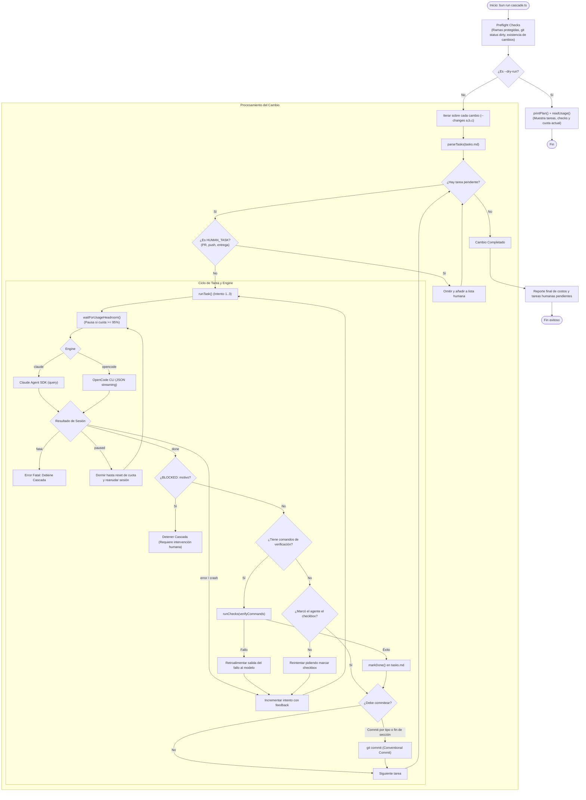

# Análisis de Arquitectura y Funcionamiento del CLI (`openspec-cascade`)

`openspec-cascade` es un ejecutor autónomo diseñado para procesar cambios estructurados según el estándar [OpenSpec](https://github.com/Fission-AI/OpenSpec). Ejecuta los cambios tarea por tarea, iniciando una sesión aislada de agente para cada ítem en `tasks.md` y garantizando que solo el código verificado y probado termine en el historial de Git.

---

## 1. Principios de Diseño

1. **El Arnés como Oráculo (*The Harness as the Oracle*):**
   * El LLM no decide cuándo una tarea está terminada.
   * El CLI detecta y ejecuta las pruebas y comandos de verificación directamente en el entorno local (`bun test`, `lint`, `tsc`, `build`, etc.).
   * Si las pruebas fallan, el error se captura y se reinyecta al agente para un nuevo intento (hasta 3 intentos por tarea). Solo cuando los checks pasan con código de salida `0`, el CLI marca la tarea como realizada (`- [x]`) y procede al commit.

2. **Aislamiento y Soberanía de Git:**
   * El agente tiene denegado explícitamente el uso de comandos destructivos o de control de versiones (`git commit`, `git push`, `git reset`, `git checkout`, `git stash`, `bun run db:push/migrate`).
   * El arnés es el dueño exclusivo de Git y de las migraciones de base de datos.

3. **Persistencia Idempotente:**
   * No requiere base de datos externa ni daemon centralizado.
   * El estado vive en los archivos `tasks.md` y en el árbol de Git. Si una sesión se interrumpe (por límite de cuota o error fatal), reanudar el comando continúa automáticamente en la primera tarea sin marcar.

4. **Protección de Ramas y Entorno Sucio:**
   * Preflight aborta inmediatamente si se intenta ejecutar en ramas protegidas (`main`, `master`, `stable`).
   * No permite iniciar con archivos sin confirmar salvo que se pase explícitamente `--allow-dirty`.

---

## 2. Diagrama de Flujo y Arquitectura



---

## 3. Componentes del Sistema

### `cascade.ts` (Orquestador Principal)
* **Entrada y CLI (`parseArgs`):** Procesa flags como `--repo`, `--changes`, `--dry-run`, `--full-gate`, `--engine`, `--allow-dirty`, `--log-dir`, `--help`.
* **Parser de Tareas (`parseTasks`):** Lee `tasks.md`, identificando identificadores numéricos (`1.1`, `3.9`) o de tickets (`**T013**`), secciones y estados de completitud.
* **Extracción de Comandos de Verificación (`verifyCommands`):**
  * Busca cláusulas `Verify:` o frases como `"full verification"`.
  * Extrae comandos backticked (`bun test`, `bun run lint`).
  * Reemplaza `bunx tsc --noEmit` por las compilaciones específicas del proyecto (`.nuxt/tsconfig.server.json` y `.nuxt/tsconfig.app.json`).
  * Asegura que `bun run db:generate` no cree migraciones no deseadas.
  * Con `--full-gate`, cualquier tarea que realice un commit ejecuta obligatoriamente toda la suite de pruebas (`FULL_VERIFY`).
* **Lógica de Commits (`commitsPerSection`, `commitTypeOf`):**
  * Detecta si una tarea define un tipo convencional (ej. ``Commit `refactor(server)` ``).
  * Si ninguna tarea del cambio define tipos, conmuta a modo **commit por sección**, creando un único commit al terminar la última tarea de cada bloque para mantener un historial limpio.
* **Usage Guard (Claude Engine):**
  * Invoca `/usage` vía SDK antes de cada sesión y tras advertencias de límite.
  * Si la cuota de cualquier medidor supera el 95% (`USAGE_LIMIT_PERCENT`), duerme hasta su hora de reinicio (`resetsAt`) más un margen de seguridad de 2 minutos.

### `opencode.ts` (Adaptador de Motor OpenCode)
* **Subproceso en Streaming:** Lanza `opencode run --format json --auto` con un timeout de 45 minutos.
* **Inyección de Permisos:** Configura la variable de entorno `OPENCODE_CONFIG_CONTENT` dinámicamente para prohibir comandos de Git definidos en `DENIED_BASH`.
* **Reductor de Eventos (`reduceOpenCodeEvent`):**
  * Parsea líneas JSON individuales generadas por la salida del CLI.
  * Deduplica bloques de texto devueltos por el modelo.
  * Acumula el costo en dólares reportado en partes `step-finish`.
* **Clasificador de Fallos (`classifyFailure`):**
  * Errores de autenticación/credenciales inválidas (`401`, `provider.auth`) $\rightarrow$ `fatal`.
  * Límites de tasa (`429`, `rate limit`, `quota`) $\rightarrow$ `paused` (espera 30 minutos).
  * Salidas con código de error normal $\rightarrow$ `error` reintentable.

---

## 4. Referencia de Flags y Opciones

### Instalación como comando global

```bash
bun install        # dependencias de los motores
bun link           # registra el bin `openspec-cascade` en ~/.bun/bin
openspec-cascade --repo <ruta> --changes a,b
openspec-cascade --help
```

Asegúrate de que `~/.bun/bin` esté en el `PATH`. `--help` (o `-h`) imprime todos los flags, las variables de entorno y ejemplos de uso, y termina sin efectos secundarios.

| Opción / Variable | Tipo / Valor | Función |
| :--- | :--- | :--- |
| `--repo <path>` | String | Ruta al repositorio objetivo. Por defecto toma el directorio de trabajo actual. |
| `--changes <a,b>` | String (CSV) | Lista ordenada de carpetas de cambio en `openspec/changes/`. |
| `--dry-run` | Flag booleano | Muestra el plan detallado (tareas, verificaciones asociadas, tipos de commit y cuotas actuales) sin ejecutar nada. |
| `--full-gate` | Flag booleano | Obliga a que cualquier tarea que genere un commit ejecute la suite de verificación completa (`FULL_VERIFY`). |
| `--engine <nombre>` | `claude` \| `opencode` \| `antigravity` (alias `agy`) | Motor de inferencia/agente a utilizar (por defecto `claude`). |
| `--allow-dirty` | Flag booleano | Permite arrancar la ejecución aunque existan modificaciones previas sin commitear en el árbol de trabajo. |
| `--log-dir <path>` | String | Directorio de logs. Tiene prioridad sobre `CASCADE_LOG_DIR`. |
| `--help`, `-h` | Flag booleano | Muestra la ayuda y termina con código `0`. |
| `CASCADE_LOG_DIR` | Variable de entorno | Directorio de logs (el flag `--log-dir` tiene prioridad). |
| `CASCADE_MODEL` | Variable de entorno | Modelo o alias del LLM (ej. `opencode/deepseek-v4.1-flash`, `claude-3-7-sonnet-20250219`). |
| `CASCADE_EFFORT` | Variable de entorno | Nivel de esfuerzo de razonamiento (`low`, `medium`, `high`, `max`, o `none`). |

---

## 5. Auditoría y Registro (Logging)

Cada ejecución genera automáticamente un archivo de eventos estructurado en formato JSON Lines:
* **Ubicación:** `<directorio de logs>/<timestamp>.jsonl`. El directorio se resuelve en este orden: `--log-dir`, `CASCADE_LOG_DIR`, y por defecto `~/.cache/openspec-cascade/logs/<nombre del repo>/` (nombre base de `--repo`). Las rutas relativas se resuelven contra el directorio actual.
* **Creación perezosa:** el directorio y el archivo se crean en la primera escritura; con `--dry-run` no se escribe ningún log.
* **Eventos capturados:**
  * `task_start`: Inicio de procesamiento de una tarea específica.
  * `tool`: Invocaciones de herramientas por parte del agente con parámetros resumidos.
  * `text`: Respuestas y explicaciones del agente.
  * `check`: Resultados de los comandos ejecutados por el oráculo con sus códigos de retorno.
  * `commit`: Hashes SHA y mensajes de los commits generados.
  * `rate_limit_event`: Reportes de saturación de cuota y tiempos de espera calculados.
  * `result`: Costo acumulado en USD y número de turnos empleados por sesión.

---

## 6. Personalización para otros Proyectos

En su implementación base, `cascade.ts` está configurado para un stack basado en **Bun + Nuxt**. Para reutilizar el CLI en repositorios con otras tecnologías (Node, Next.js, Vite, Rust, Go, etc.), las siguientes constantes en la cabecera de `cascade.ts` son los puntos principales de ajuste:

* `DEFAULT_VERIFY`: Comandos base de verificación rápida (ej. `npm test`, `npm run lint`).
* `TSC_SERVER` / `TSC_APP`: Verificaciones de tipado específicas del proyecto.
* `FULL_VERIFY`: Suite de integración y validación completa previa a despliegue/commit mayor.
* `NO_NEW_MIGRATION`: Script de aserción para asegurar que el generador de esquema no produzca migraciones accidentales.
