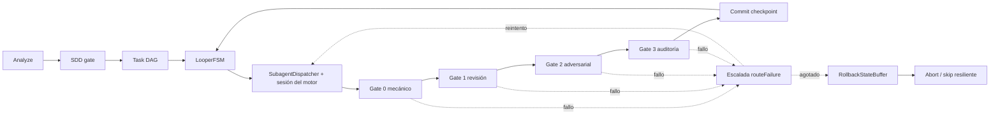

# Referencia y Arquitectura del CLI (`openspec-cascade`)

`openspec-cascade` ejecuta cambios [OpenSpec](https://github.com/Fission-AI/OpenSpec) de forma autónoma, tarea por tarea, con una sesión aislada de agente por cada ítem de `tasks.md`. El arnés —no el modelo— decide cuándo una tarea está terminada: ejecuta la verificación determinista, reinyecta los fallos al agente y solo confirma (commit) trabajo verificado.

El mismo código fuente TypeScript corre en **Bun 1.4+** y en **Node.js 24 LTS**.

---

## 1. Principios de diseño

1. **El arnés es el oráculo.** Los comandos de verificación (`Verify:` en `tasks.md`, `--full-gate`, Gates 0–3) los ejecuta el arnés; el código de salida `0` es la única prueba aceptada.
2. **Soberanía de Git.** El agente no puede hacer `commit`, `push`, `reset`, `checkout`, `stash` ni migraciones. El arnés es dueño de Git y del buffer de rollback.
3. **Estado idempotente.** El estado vive en `tasks.md`, Git y `.cascade/` (telemetría, caché). Una ejecución interrumpida se reanuda en la primera tarea pendiente.
4. **Fail-closed.** Entradas inválidas, presupuestos agotados, ramas protegidas (`main`, `master`, `stable`) o árboles sucios detienen la ejecución con código `2`.
5. **Spec antes que código.** El hook SDD del plugin y la puerta SDD del pipeline v2 bloquean cambios de código de producción sin un cambio OpenSpec activo.

---

## 2. Ejecución en Bun y en Node.js 24

```bash
# Bun (recomendado)
bun run cascade.ts --repo <ruta> --changes cambio-a,cambio-b

# Node.js 24 LTS (sin transpilar: el hook resuelve imports sin extensión)
node --import ./scripts/node_ts_register.mjs cascade.ts --repo <ruta> --changes cambio-a --dry-run
```

Toda ejecución de procesos pasa por el puerto `ISpawner` (`src/runtime/`): `BunSpawner` en Bun y `NodeSpawner` en Node. Ambos aíslan cada proceso en su propio grupo, matan el árbol completo en timeout/abort (`SIGTERM` → `SIGKILL` tras una gracia) y devuelven `124` en timeout.

---

## 3. Modos de ejecución (`--mode`)

### `--mode v1` (por defecto)

Bucle secuencial: por cada tarea pendiente se abre una sesión del motor, se ejecutan los comandos `Verify:` (hasta `--max-attempts` intentos con el fallo reinyectado), se marca la tarea y se hace commit por tipo o por sección. Si se agotan los intentos se ejecuta el rollback de Git (`--no-rollback` lo desactiva) y la ejecución se detiene, salvo con `--resilient`.

### `--mode v2` (pipeline FSM)



- **Analyze** (`analyzeChangeArtifacts`) bloquea cambios con brechas entre proposal, specs y tasks.
- **HarnessInjector** construye el prompt determinista: tarea, reglas, directivas de remediación, artefactos del cambio, constitución (`openspec/project.md`), skills, contexto Greptile y guardarraíles.
- **Gates 1–3 reciben el diff completo del árbol de trabajo** (incluidos archivos nuevos sin seguimiento) calculado mediante un *shadow commit*, sin tocar el índice del usuario.
- **Gate 2** (sondas adversariales sintetizadas) se ejecuta con `--full-gate` cuando Bun está disponible y hay archivos de código.
- Los artefactos de los gates viven en `.agents/teamwork/` y nunca entran en los commits; el estado de la ejecución se persiste con `MemoryStorage`.

---

## 4. Motores (`--engine`)

| Motor | Alias | Transporte | Notas |
|---|---|---|---|
| `claude` | — | Claude Agent SDK | Por defecto; medidores de uso del plan (`--usage-limit`). |
| `opencode` | — | CLI `opencode run --format json` | Modelo `proveedor/modelo#variante`. |
| `antigravity` | `agy`, `gemini` | CLI `agy` | Coste estimado por tokens. |
| `jules` | — | CLI `jules remote` vía `PalEngineBridge` | Autenticación interactiva `jules login`; la API REST usa `X-Goog-Api-Key`. |

Cada motor se construye con `EngineFactory` y se envuelve con `ResilientEngineDecorator` (reintentos con backoff exponencial + jitter y *circuit breaker*) y `TelemetryMetricsDecorator` (latencia, coste, tokens, reintentos, categoría de error).

---

## 5. Opciones

| Opción | Variable de entorno | Descripción |
|---|---|---|
| `--repo <ruta>` | `CASCADE_REPO` | Repositorio destino (por defecto el directorio actual). |
| `--changes a,b,c` | `CASCADE_CHANGES` | Cambios OpenSpec en orden de cascada. Los ids deben cumplir `[A-Za-z0-9][A-Za-z0-9._-]*` (sin separadores ni `..`). |
| `--engine <nombre>` | `CASCADE_ENGINE` | `claude`, `opencode`, `antigravity` (`agy`, `gemini`) o `jules`. |
| `--model <nombre>` | `CASCADE_MODEL` | Modelo para el motor seleccionado. |
| `--effort <nivel>` | `CASCADE_EFFORT` | `low`, `medium`, `high`, `max` o `none`. |
| `--mode <v1\|v2>` | — | Pipeline secuencial (`v1`) o FSM con Gates 0–3 (`v2`). |
| `--config <ruta>` | `CASCADE_CONFIG` | Archivo `.openspec-cascade.json`. |
| `--budget <usd>` / `--max-budget` | `CASCADE_MAX_BUDGET_USD` | Presupuesto máximo por sesión (`>=` detiene). |
| `--total-budget <usd>` | `CASCADE_TOTAL_BUDGET_USD` | Presupuesto total de la cascada. |
| `--usage-limit <%>` | `CASCADE_USAGE_LIMIT_PERCENT` | Límite de uso del plan (1–100). |
| `--max-turns <n>` | `CASCADE_MAX_TURNS` | Turnos máximos por sesión. |
| `--max-attempts <n>` | `CASCADE_MAX_ATTEMPTS` | Intentos máximos por tarea. |
| `--allow-dirty` | `CASCADE_ALLOW_DIRTY` | Permite iniciar con el árbol sucio. |
| `--dry-run` | `CASCADE_DRY_RUN` | Muestra el plan (y en v2 el veredicto de Analyze y el orden del DAG) sin ejecutar ni escribir logs. |
| `--full-gate` | `CASCADE_FULL_GATE` | Verificación completa en cada tarea con commit; habilita Gate 2 en v2. |
| `--no-keep-alive` | `CASCADE_KEEP_ALIVE=false` | Desactiva el inhibidor de suspensión (`caffeinate` / `systemd-inhibit`). |
| `--log-dir <ruta>` | `CASCADE_LOG_DIR` | Directorio de logs JSONL (por defecto `~/.cache/openspec-cascade/logs/<repo>`). |
| `--settings <archivo>` | `CASCADE_SETTINGS` | Settings extra de Claude Code para cada sesión (solo motor `claude`), p. ej. un sandbox para ejecuciones desatendidas. Se resuelve contra el directorio actual; si no existe, la ejecución se detiene con `2`. |
| `--no-diagrams` | `CASCADE_AUTO_DIAGRAMS=false` | Desactiva la sincronización de diagramas al completar un cambio. |
| `--graphify-command <cmd>` | `CASCADE_GRAPHIFY_COMMAND` | Comando para actualizar el grafo Graphify. |
| `--archify-action <acción>` | `CASCADE_ARCHIFY_ACTION` | Acción de Archify (por defecto `deliver`). |
| `--archify-quality <perfil>` | `CASCADE_ARCHIFY_QUALITY` | Perfil de calidad de Archify (por defecto `showcase`). |
| `--archify-bin <ruta>` | `CASCADE_ARCHIFY_BIN` | Binario o prefijo de comando de Archify. |
| `--no-rollback` | `CASCADE_ROLLBACK_ON_FAILURE=false` | Conserva el árbol de trabajo cuando una tarea falla. |
| `--resilient` / `--continue-on-failure` | `CASCADE_RESILIENT` | Continúa con la siguiente tarea tras un fallo (con rollback). |
| `-h`, `--help` | — | Muestra la ayuda. |

Precedencia: overrides programáticos > CLI > `CASCADE_*` > `.openspec-cascade.json` > valores por defecto.

### Comandos de verificación desde `tasks.md`

Solo se aceptan spans entre backticks que empiecen por `bun`, `bunx`, `npm`, `pnpm`, `yarn` o `tsc --noEmit`, y **se descartan** los que contengan operadores de control de shell (`;`, `&`, `|`, `` ` ``, `$(`, `${`, `>`, `<`, saltos de línea). Si no queda ninguno se aplica la verificación por defecto.

---

## 6. Subcomandos

| Subcomando | Uso | Salida |
|---|---|---|
| `doctor` | `cascade.ts doctor [--repo <ruta>]` | Diagnóstico de runtime, git, OpenSpec, binarios de motores, Greptile, sincronía de hooks y telemetría. `0` si no hay checks `fail`. |
| `catalog` | `cascade.ts catalog --sync --owner <o> --project <n> [--owner-type user\|organization] [--output <dir>]` | Genera el catálogo de tareas desde un GitHub Project (requiere `gh` autenticado). |
| `drift` | `cascade.ts drift --catalog <archivo> (--remote-json <archivo> \| --owner <o> --project <n>)` | Compara el catálogo local con el proyecto o con una instantánea JSON. `1` si hay drift. |
| `review` | `cascade.ts review --base <rama> [--rounds <n≤3>] [--repo <ruta>] [--engine <motor>]` | Bucle pre-PR acotado: revisión Greptile sobre un shadow worktree, corrección automática de hallazgos mecánicos, parada en hallazgos de riesgo. `0` si queda limpio. |

| `spec-gate` | `cascade.ts spec-gate check --stage <review\|drift> --changes <a,b> [--repo <ruta>]`<br>`cascade.ts spec-gate stamp --stage <review\|drift> --change <a> --status <resolved\|open> [--repo <ruta>]` | Comprueba (`check`) o sella (`stamp`) los informes EGM `review.md` y `drift.md` de un change de OpenSpec. `0` si todos los changes pasan; `1` si alguno falta, está abierto, caducó o no tiene bloque de estado. |

Códigos de salida de los subcomandos: `0` éxito, `1` hallazgos/drift/estado no saludable, `2` entrada inválida o error fail-closed (por ejemplo, Greptile no instalado).

### Ciclo EGM alrededor de cascade (`spec-gate`)

[EGM](https://github.com/google/elephant-goldfish-model) (instalar con `claude plugin install egm@egm`) añade revisores "pez dorado" sin contexto previo. OpenSpec sigue siendo la fuente de verdad: los informes viven dentro de `openspec/changes/<change>/`.

```text
/cascade-spec-brainstorm <change> <idea>   → brief.md
/opsx-propose                              → proposal, design, specs, tasks
/cascade-spec-review <change>              → review.md  (+ spec-gate stamp --stage review)
spec-gate check --stage review             → debe dar 0 antes de night-run / cascade
cascade --changes <change>                 → apply
/cascade-spec-drift <change>               → drift.md   (+ spec-gate stamp --stage drift)
spec-gate check --stage drift              → debe dar 0 antes de /opsx-archive
```

- `stamp` escribe al principio del informe un bloque `---` con `egm`, `status` (`resolved` o `open`) y `hash`. El hash cubre `proposal.md`, `design.md`, `tasks.md` y `specs/*/spec.md`; ignora las casillas `[x]` de las tareas y los finales de línea CRLF, de modo que marcar tareas durante `apply` no invalida la revisión. Editar cualquier artefacto después de sellar deja el informe `stale`.
- `check` informa de todos los changes que fallan, no solo del primero. Los motivos son `missing`, `malformed`, `open` y `stale`.
- Es opt-in: nada lo ejecuta salvo que se llame. `night-run` debe invocar `spec-gate check --stage review --changes <lista>` antes de lanzar y abortar si no sale `0`.
- Solape con las skills existentes: `sdd-clarify` (preguntas ligeras) y `sdd-checklist` (rúbrica en el mismo contexto) son la primera pasada barata; EGM es la segunda, con contexto limpio. `sdd-verify` prueba el comportamiento en runtime y no sustituye a la comprobación de drift.

---

## 7. Integración con Greptile

- Solo se usa la superficie documentada del CLI v3: `greptile review --json [--branch <base>]`, `greptile review status --json`, `greptile whoami`, `GREPTILE_API_KEY`.
- El CLI revisa únicamente cambios confirmados, por lo que `ShadowCommitManager` crea un commit sombra (índice aislado con `GIT_INDEX_FILE`, ref privada `refs/cascade/shadow/*`) y lo expone en un *worktree* temporal; todo se limpia en `finally`.
- Los resultados verificados se cachean en `.cascade/cache/greptile/` con clave SHA-256 de `(merge-base, hash del diff, consulta)`.
- `verifyReviewFindings` rechaza respuestas en menos de 10 s (caché obsoleta) y hallazgos que no coinciden con el diff respecto a `git merge-base`.

---

## 8. Auto-mejora y telemetría

Con `telemetry.enabled` (por defecto), cada sesión y cada fallo de verificación o de gate se registra, redactado, en `.cascade/telemetry/<AAAA-MM-DD>.jsonl`. `SelfImprover` normaliza las trazas en firmas estables y convierte las recurrentes (≥ 2) en un máximo de 5 directivas de remediación que se inyectan en los siguientes prompts. `.cascade/` está ignorado por Git, nunca entra en commits y sobrevive al rollback.

---

## 9. Plugin de Claude Code

`node bin/install.mjs` registra el marketplace y el plugin `cascade` (agentes, comandos `/cascade`, `/cascade-looper`, `/cascade-spec-brainstorm`, `/cascade-spec-review` y `/cascade-spec-drift`, skills y el hook `PreToolUse`). El hook (`sdd_gate.mjs` / `sdd_gate.cjs`, lógica en `sdd_gate_core.cjs`) lee `sdd_rules.json`, generado desde `SDD_CONSTANTS` con `bun run scripts/sync_plugin.ts`; `--check` falla si está desactualizado.

---

## 10. Verificación y CI

```bash
bunx tsc --noEmit
bunx eslint .
bun run scripts/forensic_audit.ts
bun run scripts/sync_plugin.ts --check
bunx openspec validate --all --strict
bun test
npm run test:node   # requiere Node.js 24
```

El workflow de CI se versiona en `ci/github-workflows/ci.yml`. Para activarlo, un mantenedor con credenciales con el scope `workflow` debe copiarlo:

```bash
mkdir -p .github/workflows && cp ci/github-workflows/ci.yml .github/workflows/ci.yml
```

Un test exige que la copia instalada sea idéntica a la plantilla.
